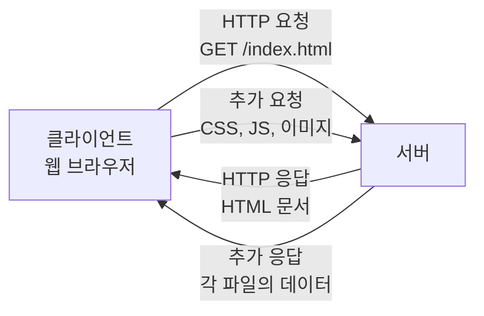
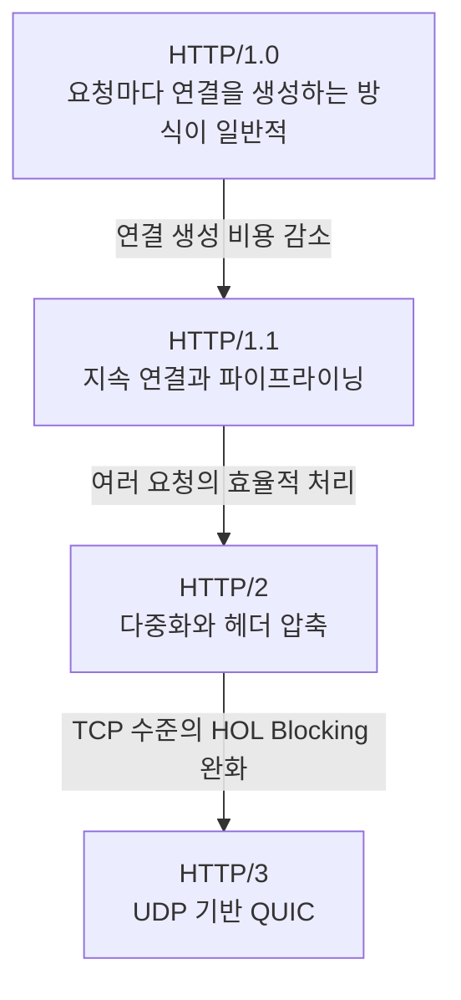
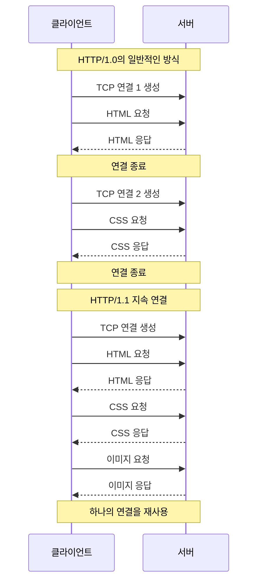
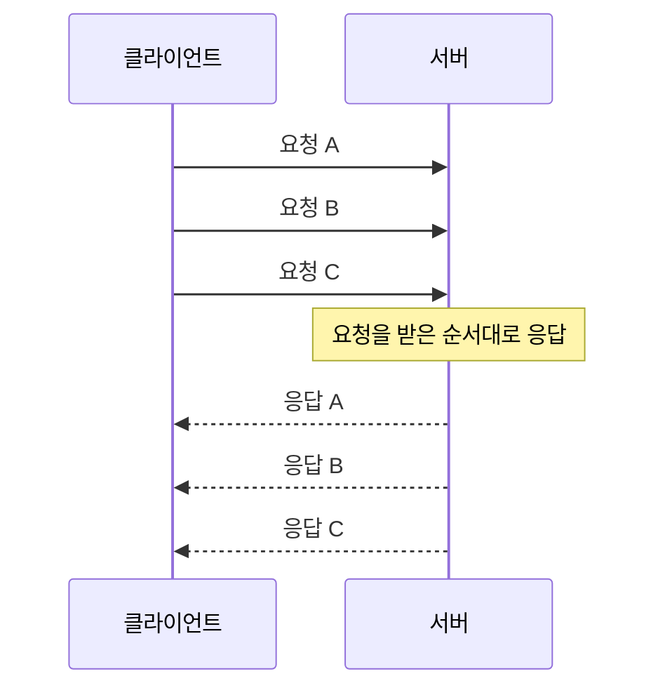
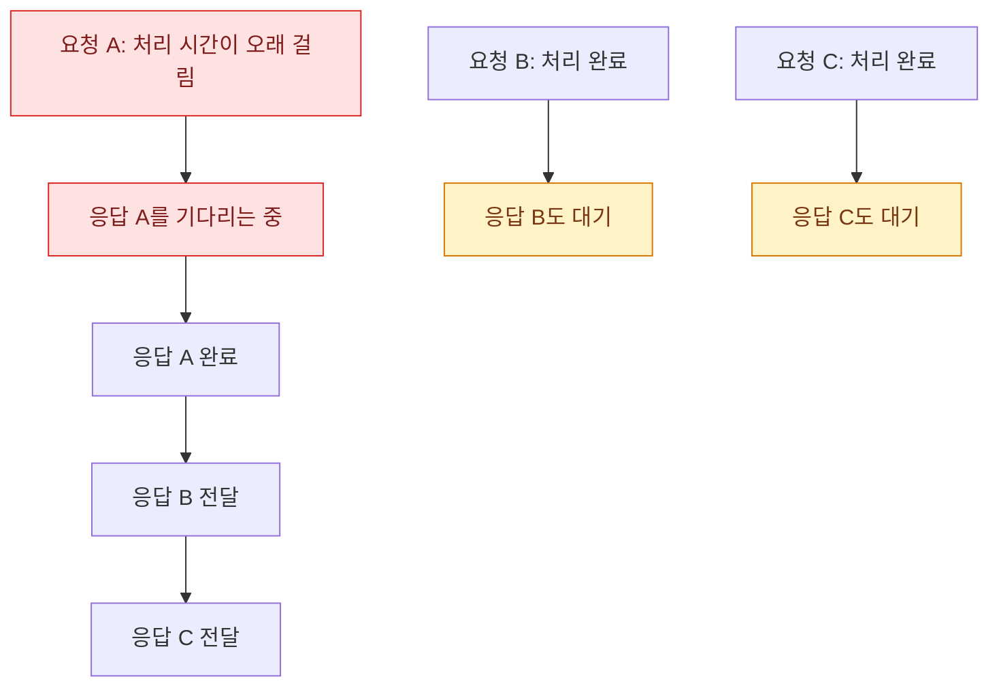
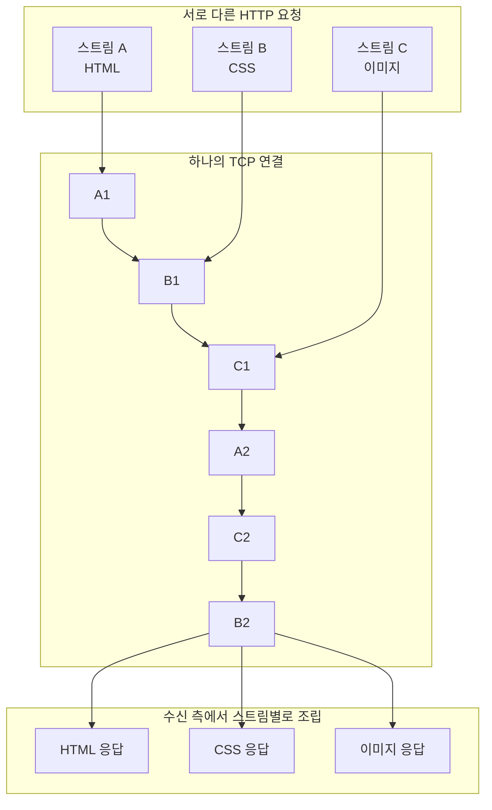
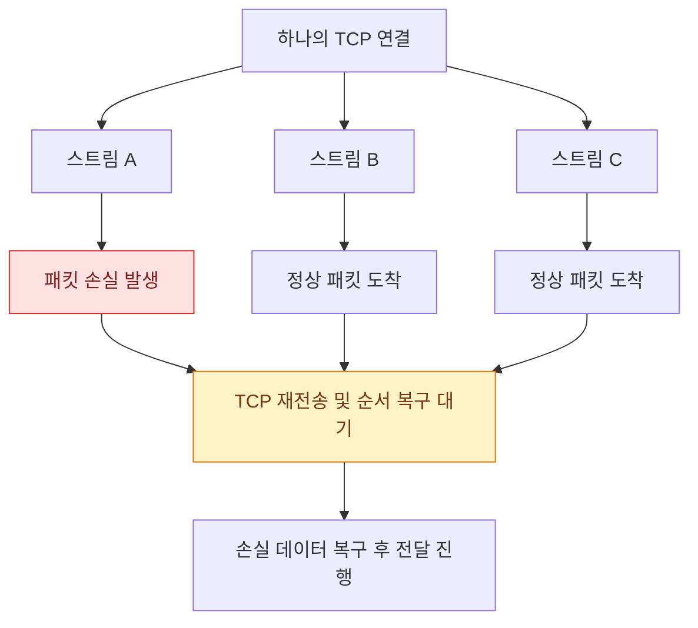
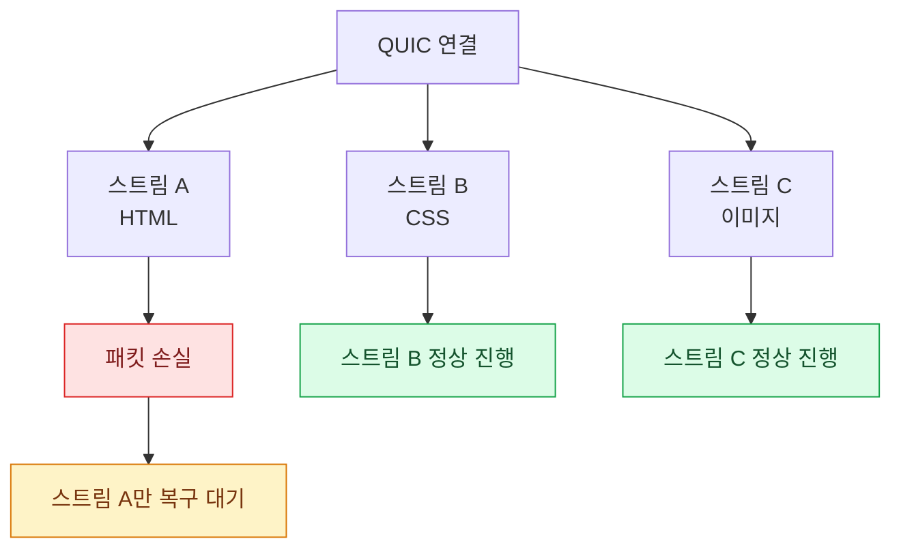
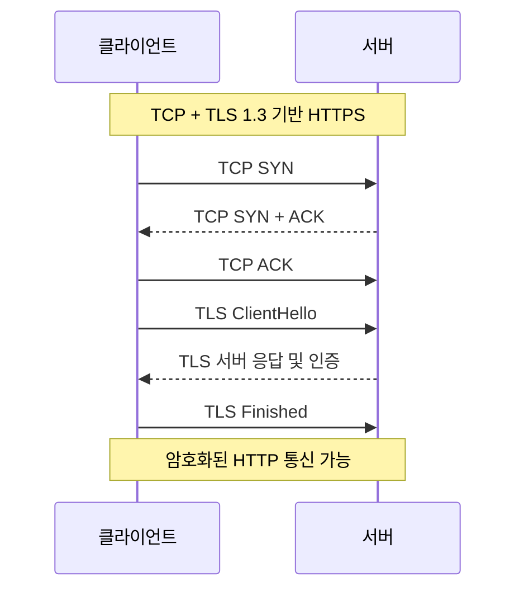
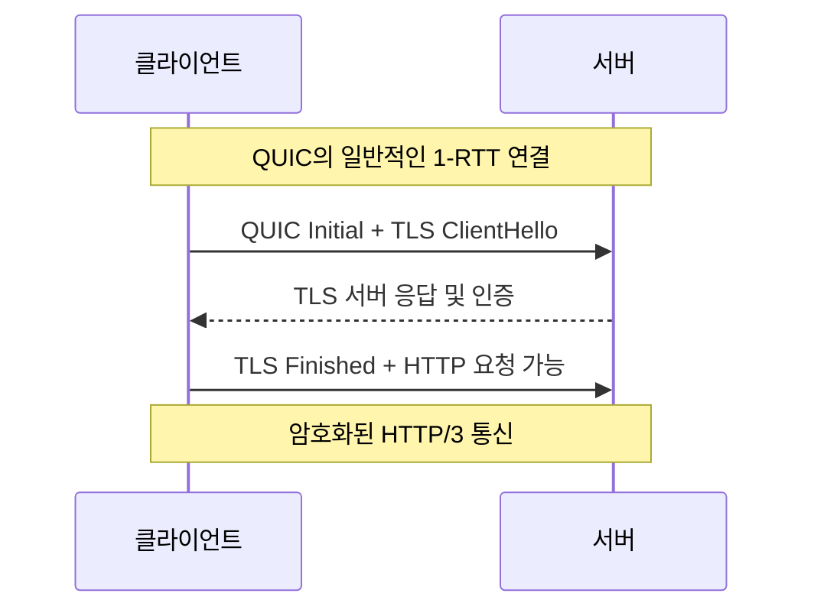

# 📑 HTTP 버전별 진화 (HTTP/1.1, HTTP/2, HTTP/3 QUIC) 정리

> **발표자**: 최묘석  
> **날짜**: 2026-11-17  
> **카테고리**: Network  
> **참고 링크**: [gyoogle 기술인터뷰 - Network](https://github.com/gyoogle/tech-interview-for-developer/tree/master/Computer%20Science/Network)

---

## 1. 개요 및 정의

> HTTP가 버전별로 발전한 배경과 각 버전이 해결하려는 네트워크 통신 문제를 정리.

### HTTP란?

**HTTP(HyperText Transfer Protocol, 하이퍼텍스트 전송 프로토콜)**는 클라이언트와 서버가 웹에서 데이터를 주고받기 위한 통신 규약이다.

웹 브라우저에서 웹사이트에 접속하면 브라우저가 서버에 HTTP 요청(Request)을 보내고, 서버는 해당 요청을 처리하여 HTTP 응답(Response)을 반환한다.

예를 들어 웹페이지 하나를 표시하려면 HTML 문서뿐만 아니라 CSS, JavaScript, 이미지 등의 파일도 필요하다.

브라우저는 이러한 파일들을 서버에 요청하고 응답받는 과정을 반복한다.

초기의 웹페이지는 비교적 단순했지만, 웹사이트가 복잡해지면서 한 페이지를 표시하기 위해 주고받아야 하는 데이터와 요청의 수가 증가했다.

이에 따라 HTTP는 **연결을 효율적으로 재사용하고, 여러 요청을 빠르게 처리하며, 네트워크 지연을 줄이는 방향**으로 발전했다.

### HTTP 버전별 발전 과정

각 버전의 핵심 특징은 다음과 같다.

| 버전 | 핵심 기술 | 개선하려는 문제 |
| :--- | :--- | :--- |
| HTTP/1.1 | 지속 연결, 파이프라이닝 | 반복적인 TCP 연결 생성 비용 |
| HTTP/2 | 다중화, HPACK, 서버 푸시 | 요청 처리의 비효율성과 중복 헤더 |
| HTTP/3 | QUIC, 독립적인 스트림 | TCP 수준의 HOL Blocking과 연결 설정 지연 |

HTTP 버전이 발전하더라도 `GET`, `POST`, `200 OK`, `404 Not Found`처럼 HTTP 요청과 응답이 가지는 기본적인 의미는 유지된다.

주로 달라지는 것은 **메시지를 네트워크로 전달하는 방식**이다.

---

## 2. 핵심 동작 원리 및 특징

### 2-1. 먼저 알아야 할 네트워크 용어

HTTP 버전별 차이를 이해하려면 다음 용어들을 먼저 구분해야 한다.

| 용어 | 의미 |
| :--- | :--- |
| TCP(전송 제어 프로토콜) | 데이터를 순서대로 신뢰성 있게 전달하기 위한 프로토콜 |
| UDP(사용자 데이터그램 프로토콜) | 연결 설정 없이 데이터그램을 전달하며, 신뢰성 보장 기능을 기본적으로 제공하지 않는 프로토콜 |
| 연결(Connection) | 클라이언트와 서버 사이에 통신을 수행하기 위해 형성된 논리적인 통신 관계 |
| 지연 시간(Latency) | 데이터나 요청이 전달되고 처리되는 데 걸리는 시간 |
| 패킷(Packet) | 네트워크에서 전달되는 데이터 단위 |
| 스트림(Stream) | 하나의 연결 안에서 구분하여 관리하는 논리적인 데이터 흐름 |
| 헤더(Header) | 요청이나 응답의 처리에 필요한 부가 정보 |
| 왕복 시간(RTT) | 데이터가 상대방에게 전달되고 응답이 돌아오는 데 걸리는 시간 |

특히 **TCP와 UDP의 차이**는 HTTP/3을 이해하는 데 중요하다.

TCP는 데이터의 순서와 신뢰성을 보장하는 기능을 제공하지만, UDP는 이러한 기능을 기본적으로 제공하지 않는다.

HTTP/3은 UDP를 사용하면서도 QUIC 프로토콜을 통해 신뢰성 있는 데이터 전달 기능을 구현한다.

### 2-2. HTTP/1.1 - 지속 연결과 파이프라이닝

HTTP/1.0에서는 일반적으로 요청과 응답을 처리할 때마다 TCP 연결을 새로 생성하는 방식이 사용되었다.

하지만 웹페이지에 필요한 파일이 많아지면 연결을 반복해서 생성하고 종료하는 과정에서 불필요한 시간이 발생한다.

이를 개선하기 위해 HTTP/1.1에서는 **지속 연결(Persistent Connection)**이 기본 방식으로 사용된다.

#### 지속 연결(Keep-Alive)

지속 연결은 하나의 TCP 연결을 여러 HTTP 요청과 응답에 재사용하는 방식이다.

지속 연결을 사용하면 요청마다 TCP 연결을 새로 생성할 필요가 없어 연결 설정 비용을 줄일 수 있다.

다만 지속 연결을 사용한다고 해서 여러 요청이 자동으로 동시에 처리되는 것은 아니다.

#### 파이프라이닝(Pipelining)

파이프라이닝은 이전 요청의 응답을 기다리지 않고 다음 요청을 연속해서 보내는 방식이다.

요청을 연속해서 전송할 수 있다는 장점이 있지만, 응답은 요청 순서대로 반환되어야 한다.

따라서 앞선 요청의 처리가 늦어지면 뒤에 있는 응답도 기다려야 하는 문제가 발생한다.

또한 파이프라이닝은 구현과 호환성 문제 등으로 실제 브라우저에서 널리 활용되지 못했다.

#### HOL Blocking이란?

**HOL Blocking(Head-of-Line Blocking, 선두 지연 문제)**은 앞에 있는 데이터나 요청의 처리가 지연되면서 뒤에 있는 데이터까지 기다리게 되는 현상이다.

HTTP/1.1의 파이프라이닝에서는 앞선 요청의 응답이 지연되면 뒤따르는 응답도 전달되지 못한다.

예를 들어 이미지 A의 처리 시간이 길어지면, 이미 처리가 끝난 CSS나 JavaScript 응답도 앞선 응답 때문에 대기할 수 있다.

이러한 문제를 해결하기 위해 HTTP/2에서는 다중화 기술이 도입되었다.

### 2-3. HTTP/2 - 다중화와 헤더 압축

HTTP/2는 HTTP/1.1의 요청 처리 비효율성을 개선하기 위해 등장했다.

대표적인 특징은 다음과 같다.

- 다중화(Multiplexing)
- 이진 프레이밍(Binary Framing)
- 헤더 압축(HPACK)
- 서버 푸시(Server Push)

#### 다중화(Multiplexing)

다중화는 **하나의 TCP 연결에서 여러 HTTP 요청과 응답을 동시에 진행할 수 있도록 하는 기술**이다.

HTTP/1.1에서는 하나의 연결에서 요청과 응답의 순서가 문제가 되었지만, HTTP/2에서는 요청별로 스트림을 구분한다.

스트림의 데이터를 여러 프레임(Frame)으로 나누어 전송하고, 수신 측에서 다시 조립한다.

위 그림에서 A1, A2는 스트림 A에 속한 프레임을 의미한다.

서로 다른 요청의 프레임을 섞어서 전송하더라도 스트림 식별 정보를 이용해 원래 요청에 맞게 조립할 수 있다.

따라서 하나의 HTTP 응답이 끝날 때까지 다른 응답이 반드시 기다릴 필요가 없다.

#### 이진 프레이밍(Binary Framing)

HTTP/1.1은 사람이 읽을 수 있는 텍스트 형식으로 메시지를 전달한다.

반면 HTTP/2는 메시지를 이진 형식의 프레임으로 나누어 전송한다.

| 용어 | 의미 |
| :--- | :--- |
| 이진(Binary) | 데이터를 컴퓨터가 처리하기 쉬운 이진 형식으로 표현하는 방식 |
| 프레임(Frame) | HTTP/2에서 메시지를 나누어 전송하는 기본 단위 |
| 스트림 식별자(Stream ID) | 프레임이 어떤 스트림에 속하는지 구분하는 번호 |
| 다중화(Multiplexing) | 여러 스트림의 데이터를 하나의 연결에서 함께 전송하는 기술 |

이진 프레이밍을 통해 여러 요청의 프레임을 효율적으로 관리하고 전송할 수 있다.

#### 헤더 압축(HPACK)

HTTP 요청에는 URL 경로, 쿠키, 브라우저 정보 등 여러 헤더가 포함된다.

같은 서버에 반복적으로 요청을 보내면 유사한 헤더가 여러 번 전송될 수 있다.

HTTP/2는 **HPACK**이라는 헤더 압축 방식을 사용하여 중복되는 헤더 정보의 전송량을 줄인다.

예를 들어 동일한 브라우저가 여러 이미지를 요청한다면, 반복되는 헤더 값을 매번 그대로 전송하지 않고 압축된 형태로 표현할 수 있다.

#### 서버 푸시(Server Push)

서버 푸시는 클라이언트가 명시적으로 요청하기 전에 서버가 필요할 것으로 예상되는 리소스를 미리 전송할 수 있도록 하는 기능이다.

예를 들어 HTML 문서와 함께 필요한 CSS 파일을 서버가 미리 전달하는 방식이다.

다만 서버 푸시는 캐시와의 중복, 불필요한 데이터 전송 등의 문제가 있어 주요 브라우저에서 지원이 중단되거나 제한되었다.

따라서 HTTP/2의 특징으로 알아둘 필요는 있지만, 현재 웹 개발에서 적극적으로 사용하는 기능으로 보기는 어렵다.

### 2-4. HTTP/2에서도 HOL Blocking이 발생하는 이유

HTTP/2는 다중화를 통해 HTTP/1.1의 응답 순서 문제를 개선했다.

하지만 HTTP/2는 여전히 **하나의 TCP 연결**을 사용한다.

TCP는 데이터를 순서대로 전달하는 프로토콜이다.

따라서 TCP 패킷이 손실되면 해당 데이터를 재전송받아야 하며, 이후 도착한 데이터도 순서가 복구될 때까지 상위 계층에 전달되지 못할 수 있다.

즉, HTTP/2는 HTTP 계층의 HOL Blocking을 개선했지만, **TCP 계층에서 발생하는 HOL Blocking까지 해결하지는 못했다.**

이 문제가 HTTP/3이 등장한 중요한 배경이다.

### 2-5. HTTP/3 - UDP 기반 QUIC

HTTP/3은 기존의 TCP 대신 **QUIC**이라는 전송 프로토콜을 사용한다.

QUIC은 UDP를 기반으로 구현된 프로토콜로, 다중 스트림, 신뢰성 있는 데이터 전달, 혼잡제어, 암호화 등을 지원한다.

여기서 중요한 점은 HTTP/3이 UDP의 기본 기능만 사용하는 것이 아니라, **UDP 위에서 QUIC이 필요한 전송 기능을 직접 구현한다는 것**이다.

#### QUIC이란?

**QUIC**은 UDP 기반의 보안 전송 프로토콜이다.

HTTP/3에서는 QUIC을 이용해 여러 스트림을 독립적으로 관리한다.

| 용어 | 의미 |
| :--- | :--- |
| QUIC | UDP를 기반으로 신뢰성 있는 전송과 다중 스트림을 지원하는 프로토콜 |
| UDP | 연결 설정과 순서 보장 기능을 기본적으로 제공하지 않는 전송 프로토콜 |
| TLS 1.3 | 통신 내용을 암호화하고 상대방을 인증하기 위한 보안 프로토콜 |
| 독립적인 스트림 | 다른 스트림의 데이터 전달과 구분하여 관리되는 데이터 흐름 |
| 패킷 손실(Packet Loss) | 전송된 패킷이 목적지에 정상적으로 도착하지 못하는 현상 |
| 재전송(Retransmission) | 손실된 데이터를 다시 보내는 과정 |

#### QUIC의 독립적인 스트림

HTTP/3에서는 QUIC 스트림별로 데이터의 순서를 관리한다.

따라서 하나의 스트림에서 데이터가 손실되더라도 다른 스트림의 데이터까지 반드시 기다릴 필요가 없다.

HTTP/2에서는 TCP 연결 전체의 순서 보장 때문에 다른 스트림까지 영향을 받을 수 있다.

반면 HTTP/3에서는 손실된 데이터가 속한 스트림을 중심으로 복구가 이루어지므로, 다른 스트림은 계속 진행할 수 있다.

다만 HTTP/3이 **모든 종류의 HOL Blocking을 완전히 제거하는 것은 아니다.**

같은 스트림 내부에서는 여전히 데이터 순서를 보장해야 하므로 손실된 데이터의 복구를 기다릴 수 있다.

HTTP/3이 해결하는 핵심 문제는 **서로 다른 스트림 사이에서 발생하던 TCP 수준의 HOL Blocking**이다.

### 2-6. QUIC의 연결 설정 과정

HTTP/2는 일반적으로 TCP 연결을 설정한 뒤 TLS 핸드셰이크를 진행한다.

반면 QUIC은 TLS 1.3을 연결 설정 과정에 통합하여 필요한 왕복 횟수를 줄인다.

QUIC은 일반적인 신규 연결에서 약 1-RTT의 핸드셰이크를 지원한다.

또한 이전에 연결한 서버와 다시 통신할 때는 조건에 따라 **0-RTT**를 이용해 핸드셰이크 완료 전부터 일부 데이터를 전송할 수도 있다.

다만 0-RTT는 재전송 공격(Replay Attack)에 대한 고려가 필요하므로 모든 요청에 무조건 적용되는 것은 아니다.

### 2-7. HTTP 버전별 전체 비교

| 비교 항목 | HTTP/1.1 | HTTP/2 | HTTP/3 |
| :--- | :--- | :--- | :--- |
| 전송 기반 | TCP | TCP | UDP 기반 QUIC |
| 연결 재사용 | 지속 연결 | 지속 연결 | QUIC 연결 |
| 다중화 | 지원하지 않음 | 지원 | 지원 |
| 메시지 전송 | 텍스트 기반 | 이진 프레임 | QUIC 스트림 기반 프레임 |
| 헤더 압축 | 기본 지원 없음 | HPACK | QPACK |
| HOL Blocking | 응답 순서 문제 | TCP 수준에서 발생 | 스트림 간 TCP 수준 HOLB 해결 |
| 연결 설정 | TCP 연결 필요 | TCP 및 일반적으로 TLS | QUIC과 TLS 통합 |
| 서버 푸시 | 지원하지 않음 | 프로토콜상 지원 | 프로토콜상 지원 |

HTTP/3에서는 HPACK 대신 **QPACK**이라는 헤더 압축 방식을 사용한다.

QPACK은 QUIC 스트림이 독립적으로 전달되는 환경에 맞춰 설계된 방식이다.

**보충 참고**: [MDN - HTTP의 진화](https://developer.mozilla.org/ko/docs/Web/HTTP/Guides/Evolution_of_HTTP)

---

## 3. 실무 / 면접 핵심 포인트

> HTTP 버전별 성능 개선의 이유와 TCP, UDP, QUIC의 관계를 중심으로 정리.

### Q1. HTTP/1.1의 한계와 HTTP/2의 Multiplexing에 대해 설명하시오.

- **A**: HTTP/1.1은 지속 연결을 통해 TCP 연결을 재사용할 수 있지만, 하나의 연결에서 여러 응답을 동시에 처리하는 데 한계가 있습니다.

  파이프라이닝을 사용하더라도 응답 순서를 유지해야 하므로 앞선 요청의 응답이 지연되면 뒤따르는 응답도 대기하는 HOL Blocking이 발생할 수 있습니다.

  HTTP/2는 다중화(Multiplexing)를 도입하여 하나의 TCP 연결에서 여러 요청과 응답을 독립적인 스트림으로 구분하고, 각 스트림의 프레임을 섞어서 전송할 수 있도록 개선했습니다.

  하지만 TCP의 순서 보장 특성으로 인해 패킷 손실 시 다른 스트림까지 영향을 받을 수 있다는 한계는 남아 있습니다.

### Q2. HTTP/3이 TCP가 아닌 UDP를 채택한 이유를 설명하시오.

- **A**: HTTP/2는 여러 요청을 다중화할 수 있지만, 하나의 TCP 연결을 사용하기 때문에 패킷 손실이 발생하면 다른 스트림까지 영향을 받는 HOL Blocking 문제가 존재합니다.

  HTTP/3은 이러한 문제를 개선하기 위해 UDP 기반의 QUIC을 사용합니다.

  QUIC은 스트림별로 데이터를 독립적으로 관리하므로 한 스트림에서 패킷이 손실되어도 다른 스트림의 데이터 전달을 계속 진행할 수 있습니다.

  또한 TLS 1.3을 연결 설정 과정에 통합하여 연결 설정 지연을 줄일 수 있습니다.

### Q3. HTTP/2와 HTTP/3에서 HOL Blocking이 어떻게 다른지 설명하시오.

- **A**: HTTP/2는 다중화를 통해 HTTP 계층에서 발생하던 응답 순서 문제를 개선했지만, TCP 계층의 HOL Blocking은 여전히 존재합니다.

  TCP에서 데이터가 손실되면 순서가 복구될 때까지 다른 스트림의 데이터도 영향을 받을 수 있습니다.

  반면 HTTP/3은 QUIC 스트림을 독립적으로 관리하여 스트림 간 HOL Blocking을 방지합니다.

  다만 하나의 스트림 내부에서는 순서 보장이 필요하므로 손실된 데이터의 복구를 기다리는 상황이 발생할 수 있습니다.

### HTTP 버전별 개선 방향을 구분하는 이유

HTTP 버전별 특징을 조사하면서 단순히 새로운 버전이 이전 버전보다 빠르다는 점보다, **어떤 병목 현상을 해결하기 위해 기술이 변경되었는지**가 중요하다는 점을 정리했다.

HTTP/1.1은 연결을 반복해서 생성하는 비용을 줄였고, HTTP/2는 하나의 연결에서 여러 요청을 효율적으로 처리하도록 개선했다.

HTTP/3은 HTTP/2에서 남아 있던 TCP 수준의 HOL Blocking 문제를 개선하기 위해 QUIC을 도입했다.

또한 HTTP/3이 항상 가장 빠른 것은 아니다. 네트워크 상태, 서버 지원 여부, 연결 재사용 여부 등에 따라 성능 차이가 발생할 수 있다.

따라서 HTTP 버전을 비교할 때는 단순히 버전 번호보다는 전송 방식과 네트워크 환경을 함께 고려해야 한다.

### 학습하며 느낀 점

HTTP/1.1, HTTP/2, HTTP/3의 차이를 처음에는 단순한 속도 개선 과정으로 생각했다. 하지만 각 버전이 이전 버전의 구체적인 문제를 해결하기 위해 등장했다는 점을 이해할 수 있었다.

특히 HTTP/2가 다중화를 지원하는데도 HOL Blocking이 발생한다는 점이 처음에는 이해되지 않았다. 이를 조사하면서 HTTP 계층에서 요청을 독립적으로 관리하는 것과 TCP 계층에서 데이터를 순서대로 전달하는 것은 서로 다른 문제라는 점을 알게 되었다.

또한 UDP는 TCP보다 기능이 단순한 프로토콜이기 때문에 HTTP/3에서 UDP를 사용한다는 사실이 의외였다. 하지만 QUIC이 UDP 위에서 신뢰성 있는 전송과 혼잡제어 등을 직접 구현한다는 점을 알게 되면서, UDP를 사용한다고 해서 데이터의 신뢰성을 포기하는 것은 아니라는 점을 이해했다.

이번 학습을 통해 네트워크 성능을 개선하려면 단순히 하나의 프로토콜만 변경하는 것이 아니라, 여러 계층 사이의 관계와 병목 현상을 함께 고려해야 한다는 점을 정리할 수 있었다.

---

## 4. 오프라인 모임 Q&A 기록 (발표 후 작성)

> 스터디원들과 나눈 질문이나 토론 내용을 발표 후 작성.

- **Q (스터디원 A)**:
- **A (발표자)**:
- **느낀 점 / 보충할 점**:
