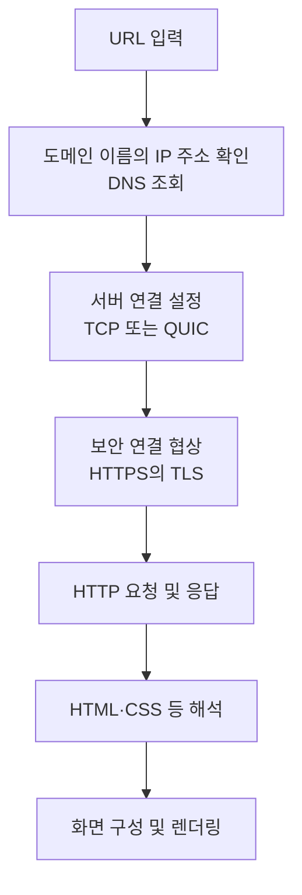
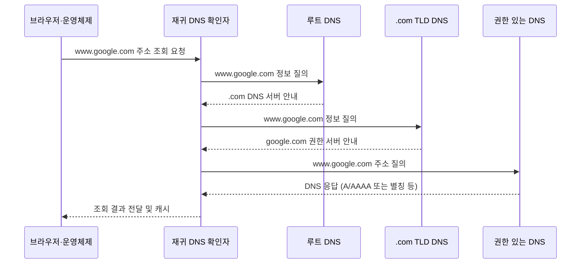
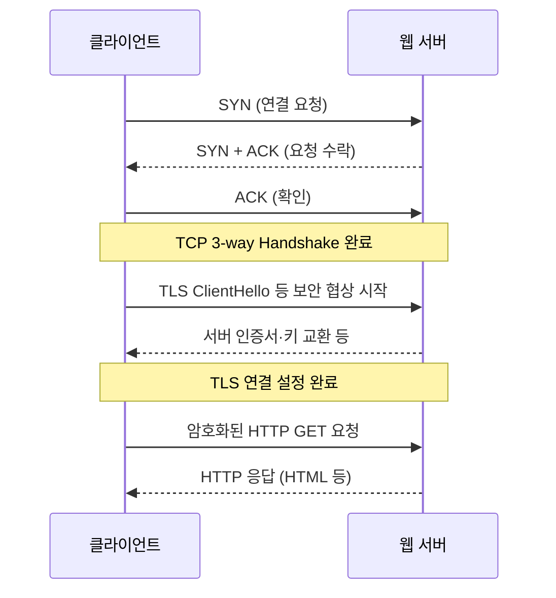
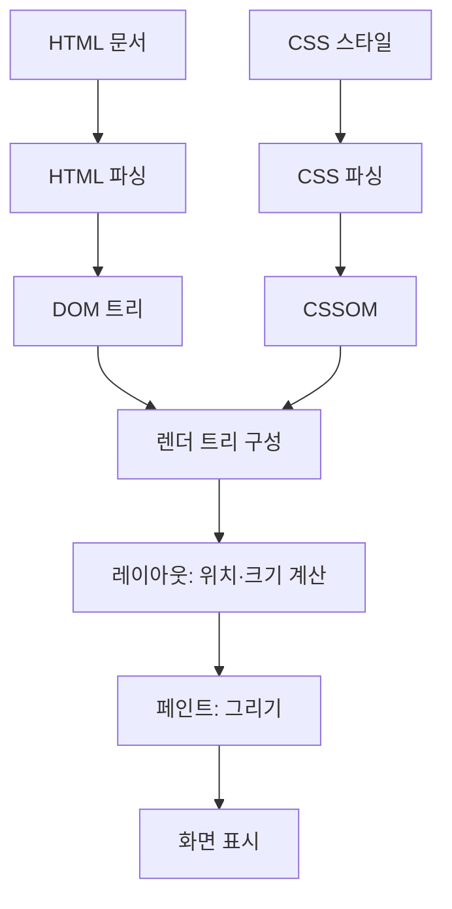

# 📑 DNS 동작 원리 / 브라우저 주소창 입력 시 흐름 정리

> **발표자**: 최묘석  
> **날짜**: 2026-11-20  
> **카테고리**: Network  
> **참고 링크**: [gyoogle 기술인터뷰 - DNS](https://github.com/gyoogle/tech-interview-for-developer/blob/master/Computer%20Science/Network/DNS.md) · [브라우저 동작 방법](https://github.com/gyoogle/tech-interview-for-developer/blob/master/Web/%EB%B8%8C%EB%9D%BC%EC%9A%B0%EC%A0%80%20%EB%8F%99%EC%9E%91%20%EB%B0%A9%EB%B2%95.md)

---

## 1. 개요 및 정의

> DNS의 역할과 브라우저가 주소를 입력받아 웹페이지를 표시하기까지의 전체 흐름을 정리한다.

### DNS란?

**DNS(Domain Name System, 도메인 이름 시스템)**는 사람이 기억하기 쉬운 도메인 이름을 통신에 필요한 IP 주소 등으로 조회할 수 있도록 하는 시스템이다.

웹사이트의 서버와 통신하려면 서버의 네트워크 주소가 필요하다. 하지만 `www.google.com`처럼 이름을 사용하는 편이 숫자로 된 IP 주소를 직접 기억하는 것보다 편리하다. DNS는 이러한 이름과 주소를 연결해 준다.

- **도메인 이름(Domain Name)**: 사람이 읽을 수 있는 인터넷상의 이름. 예: `www.google.com`
- **IP 주소(Internet Protocol Address)**: 네트워크에서 목적지를 식별하고 패킷을 전달하는 데 사용하는 주소
- **URL(Uniform Resource Locator)**: 웹에서 자원이 있는 위치와 접근 방식을 나타내는 주소. 예: `https://www.google.com/search?q=dns`

도메인 이름은 URL의 일부이며, **DNS는 웹페이지 자체를 가져오는 것이 아니라 도메인 이름에 대응하는 정보를 찾아준다.**

### 웹페이지 접속의 전체 흐름

주소창에 `https://www.google.com/`을 입력했다고 가정하면, 일반적인 흐름은 다음과 같다.



위 그림은 학습을 위한 대표적인 순서를 정리한 것이다. 실제 브라우저는 이미 존재하는 연결이나 캐시를 재사용할 수 있고, 여러 작업을 병렬로 진행하기도 한다.

---

## 2. 핵심 동작 원리 및 특징

### 2-1. DNS 조회에 등장하는 용어

| 용어 | 의미 |
| :--- | :--- |
| **호스트 파일(hosts)** | 컴퓨터에 직접 기록한 호스트 이름과 IP 주소의 대응 정보 |
| **캐시(Cache)** | 최근 조회한 결과를 일정 기간 저장해 다시 사용하는 공간 |
| **DNS 확인자(Resolver)** | 도메인 이름에 대한 DNS 조회를 수행하는 프로그램이나 서버 |
| **재귀 확인자(Recursive Resolver)** | 사용자 대신 필요한 DNS 서버에 질의하여 최종 답을 찾아주는 서버 |
| **네임서버(Name Server)** | DNS 영역에 관한 정보를 제공하는 서버 |
| **TTL(Time To Live)** | DNS 캐시의 유효 기간을 결정하는 값 |

브라우저와 운영체제는 먼저 이용 가능한 로컬 정보를 확인할 수 있다. 브라우저 캐시, 운영체제 캐시, `hosts` 파일 등의 사용 순서는 **운영체제와 브라우저 구현에 따라 다르다.** 로컬에서 결과를 찾지 못하면 설정된 DNS 확인자에 질의한다.

### 2-2. DNS의 계층적 구조

DNS는 전체 도메인 이름을 하나의 서버가 모두 관리하지 않고, 계층적으로 나누어 관리한다.

| 서버 | 역할 |
| :--- | :--- |
| **루트 DNS(Root DNS)** | `.com`, `.kr` 등 최상위 도메인을 담당하는 서버의 위치를 안내 |
| **최상위 도메인 DNS(TLD DNS)** | 해당 도메인의 권한 있는 DNS 서버를 안내 |
| **권한 있는 DNS 서버(Authoritative DNS)** | 담당 도메인의 실제 DNS 레코드를 제공 |
| **재귀 DNS 확인자(Recursive Resolver)** | 사용자의 요청을 대신 처리하고, 필요하면 위 서버들을 순서대로 조회 |

**`www.google.com`의 IP 주소를 찾는 예시**



이 과정은 **캐시에 원하는 정보가 없는 일반적인 경우**이다. 실제로는 별칭(CNAME), 여러 IP 주소, 추가적인 위임 또는 캐시 응답 때문에 단계가 달라질 수 있다.

### 2-3. 재귀 질의와 반복 질의의 차이

처음에는 루트 DNS부터 권한 있는 DNS까지의 모든 요청을 '재귀 쿼리'라고 생각하기 쉽지만, 질의 방식은 구분해야 한다.

- **재귀 질의(Recursive Query)**: 사용자가 DNS 확인자에 최종 결과를 요청하는 방식이다. 확인자가 대신 조회 작업을 수행한다.
- **반복 질의(Iterative Query)**: 확인자가 루트·TLD 등의 DNS 서버에 질의하고, 다음에 조회할 서버 정보를 전달받아 직접 다음 서버로 이동하는 방식이다.

따라서 **클라이언트 → 재귀 확인자** 구간은 재귀 질의, **재귀 확인자 → 루트 → TLD → 권한 서버**의 조회는 일반적으로 반복 질의로 설명하는 것이 정확하다.

**추가 확인**: [Cloudflare 한국어 - DNS란?](https://www.cloudflare.com/ko-kr/learning/dns/what-is-dns/)

### 2-4. DNS 레코드와 캐싱

DNS에서 반환하는 정보는 IP 주소에만 한정되지 않는다.

| 레코드 | 주요 의미 |
| :--- | :--- |
| **A** | 도메인 이름에 연결된 IPv4 주소 |
| **AAAA** | 도메인 이름에 연결된 IPv6 주소 |
| **CNAME** | 다른 도메인 이름을 가리키는 별칭 |
| **NS** | 해당 DNS 영역을 담당하는 네임서버 |

이미 조회한 결과가 캐시에 있고 TTL이 유효하다면 다시 루트·TLD 서버를 조회하지 않고 캐시의 결과를 사용할 수 있다. 이는 DNS 조회에 걸리는 시간을 줄여준다.

반대로 DNS 레코드가 변경되더라도 기존 캐시가 유효한 동안에는 이전 값이 사용될 수 있다.

### 2-5. IP 주소를 확인한 다음에는?

DNS로 서버 주소를 알아냈다면, 브라우저는 해당 서버와 통신할 연결을 사용하거나 새로 설정한다.

**TCP 기반 HTTPS(HTTP/1.1·HTTP/2)의 대표적인 흐름**



- **TCP 3-way Handshake**: 클라이언트와 서버가 TCP 연결을 설정하는 과정
- **TLS(전송 계층 보안)**: HTTPS 통신을 암호화하고 서버 인증 등을 수행하는 기술
- **HTTP 요청(Request)**: 서버에 자원을 요청하는 메시지
- **HTTP 응답(Response)**: 서버가 상태 코드와 요청한 자원 등을 반환하는 메시지

`GET /`은 서버에 기본 경로의 자원을 요청하는 HTTP 메서드와 경로의 예시이다. 서버는 `200 OK`와 HTML 문서를 반환할 수도 있고, 다른 주소로 이동시키는 **리다이렉트(Redirect)** 응답을 반환할 수도 있다.

**주의할 점:** 모든 웹 연결에서 TCP 3-way Handshake가 새로 실행되는 것은 아니다. 기존 연결을 재사용할 수 있으며, **HTTP/3은 TCP 대신 UDP 기반 QUIC을 사용**하므로 연결 설정 방식이 다르다.

### 2-6. 브라우저의 구성 요소

서버에서 HTML을 받았다고 해서 곧바로 완성된 화면이 나타나는 것은 아니다. 브라우저는 데이터를 해석하고 화면을 구성해야 한다.

| 구성 요소 | 역할 |
| :--- | :--- |
| **사용자 인터페이스(UI)** | 주소창, 뒤로 가기, 새로 고침 등 |
| **브라우저 엔진** | UI와 렌더링 엔진 사이의 동작 조정 |
| **렌더링 엔진(Rendering Engine)** | HTML·CSS 등을 해석하여 화면 표시 |
| **통신(Networking)** | HTTP 요청과 네트워크 통신 처리 |
| **자바스크립트 엔진(JavaScript Engine)** | 자바스크립트 코드 실행 |
| **UI 백엔드** | 운영체제의 그래픽 기능을 활용해 화면 요소 그리기 |
| **자료 저장소(Data Storage)** | 쿠키, 캐시 등 저장 |

### 2-7. HTML·CSS에서 화면이 만들어지는 과정

브라우저의 **렌더링(Rendering)**은 받은 문서를 실제 화면의 픽셀로 표현하는 과정이다.

먼저 자주 등장하는 용어를 구분했다.

| 용어 | 의미 |
| :--- | :--- |
| **파싱(Parsing)** | 문서를 읽고 규칙에 따라 내부 구조로 변환하는 작업 |
| **DOM(Document Object Model)** | HTML 문서의 요소를 트리 형태의 객체로 나타낸 것 |
| **CSSOM(CSS Object Model)** | CSS 스타일 정보를 객체 구조로 나타낸 것 |
| **렌더 트리(Render Tree)** | 화면에 표시할 요소와 계산된 스타일을 정리한 구조 |
| **레이아웃(Layout)** | 각 요소의 크기와 위치를 계산하는 과정 |
| **페인트(Paint)** | 요소를 화면에 그리기 위한 시각적 정보를 생성하는 과정 |



**간단한 HTML 예시**

```html
<body>
  <h1>안녕하세요</h1>
  <p>DNS를 공부하고 있습니다.</p>
</body>
```

브라우저는 이 HTML을 분석하여 `body` 아래에 `h1`과 `p`가 연결된 **DOM 트리**를 만든다. CSS를 해석한 뒤 화면에 표시할 요소의 스타일을 적용하고, 크기와 위치를 계산하여 그린다.

렌더링은 반드시 페이지의 모든 자원을 다운로드한 뒤 한 번에 실행되는 것은 아니다. 브라우저는 데이터를 받는 동안 가능한 부분부터 파싱하고 화면에 표시할 수 있다. 또한 자바스크립트 실행이나 추가 자원 요청이 렌더링 순서에 영향을 줄 수 있다.

**추가 확인**: [MDN 한국어 - 중요 렌더링 경로](https://developer.mozilla.org/ko/docs/Web/Performance/Guides/Critical_rendering_path)

### 2-8. URL 입력부터 화면 표시까지 최종 정리

| 순서 | 동작 | 핵심 내용 |
| :--- | :--- | :--- |
| 1 | URL 해석 | 프로토콜, 도메인, 경로 등을 확인 |
| 2 | DNS 조회 | 캐시 또는 DNS 서버를 통해 주소 확인 |
| 3 | 연결 설정 | TCP 또는 QUIC 연결 사용·생성 |
| 4 | 보안 협상 | HTTPS에서는 TLS로 암호화 통신 준비 |
| 5 | HTTP 요청 | 서버에 HTML 등 필요한 자원 요청 |
| 6 | HTTP 응답 | 서버가 상태 코드와 콘텐츠 반환 |
| 7 | 문서 해석 | HTML → DOM, CSS → CSSOM |
| 8 | 렌더링 | 렌더 트리 → 레이아웃 → 페인트 → 표시 |

---

## 3. 실무 / 면접 핵심 포인트

> DNS 조회와 브라우저 렌더링 과정을 하나의 흐름으로 설명하는 데 초점을 맞춘다.

### Q1. 주소창에 `www.google.com`을 입력하고 엔터를 눌렀을 때 일어나는 전체 과정을 설명하시오.

- **A**: 브라우저는 먼저 입력한 주소를 해석하고, 도메인에 대응하는 IP 주소를 확인합니다. 캐시나 로컬 설정으로 해결되지 않으면 DNS 확인자에 질의합니다. 재귀 확인자는 필요에 따라 루트 DNS, TLD DNS, 권한 있는 DNS 서버를 조회하여 주소 정보를 얻습니다.

  주소를 확인한 후에는 서버와 연결을 설정합니다. TCP 기반 HTTPS라면 TCP 3-way Handshake 이후 TLS 핸드셰이크를 진행하고, HTTP 요청을 전송하여 HTML 등의 응답을 받습니다.

  브라우저는 받은 HTML과 CSS를 각각 파싱하여 DOM과 CSSOM을 만들고, 렌더 트리를 구성합니다. 이후 레이아웃과 페인트 과정을 거쳐 웹페이지를 화면에 표시합니다.

  단, 실제로는 캐시나 기존 연결을 재사용할 수 있고, HTTP/3이라면 TCP 대신 QUIC을 사용합니다.

### Q2. DNS의 재귀 질의와 반복 질의는 어떻게 다른지 설명하시오.

- **A**: 재귀 질의는 DNS 확인자에게 최종 조회 결과를 요청하는 방식입니다. 클라이언트가 재귀 DNS 확인자에 요청하면, 확인자가 필요한 조회를 대신 수행합니다.

  반복 질의는 DNS 서버로부터 다음에 질의할 서버 정보를 받아 직접 추가 질의를 수행하는 방식입니다. 일반적으로 재귀 확인자가 루트, TLD, 권한 있는 DNS 서버에 순서대로 질의하는 과정에서 사용합니다.

### Q3. DOM과 CSSOM은 무엇이며 렌더링에서 어떤 역할을 하는지 설명하시오.

- **A**: DOM은 HTML 문서를 파싱하여 요소들의 관계를 트리 구조로 표현한 객체 모델입니다. CSSOM은 CSS 규칙을 파싱한 스타일 정보의 객체 모델입니다.

  브라우저는 두 구조를 활용해 렌더 트리를 만들고, 레이아웃 단계에서 요소의 크기와 위치를 계산한 다음 페인트 과정을 통해 화면을 그립니다.

### 학습하며 느낀 점

DNS는 단순히 도메인 이름을 IP 주소로 변환하는 기능이라고 생각했지만, 실제로는 캐시와 여러 계층의 DNS 서버가 협력하여 조회를 처리한다는 점을 알게 되었다. 특히 루트 DNS가 직접 모든 도메인의 IP 주소를 알고 있는 것이 아니라, 다음에 조회할 서버를 안내한다는 점을 이해했다.

또한 주소창에 URL을 입력하면 바로 웹페이지가 나타난다고 생각하기 쉽지만, DNS 조회와 연결 설정, HTTP 요청뿐 아니라 HTML·CSS 파싱과 렌더링까지 여러 과정이 이어진다는 점을 정리할 수 있었다.

이전까지 따로 학습했던 TCP 핸드셰이크, HTTPS의 TLS, HTTP 요청과 응답이 실제 웹사이트 접속 과정에서 서로 어떻게 연결되는지 확인할 수 있었다. 네트워크 통신이 끝난 뒤에도 브라우저가 DOM과 CSSOM을 이용해 화면을 구성한다는 점에서, 네트워크와 웹 기술을 함께 이해하는 것이 중요하다고 느꼈다.

---

## 4. 오프라인 모임 Q&A 기록 (발표 후 작성)

> 스터디원들과 나눈 질문이나 토론 내용을 발표 후 작성.

- **Q (스터디원 A)**:
- **A (발표자)**:
- **느낀 점 / 보충할 점**:
